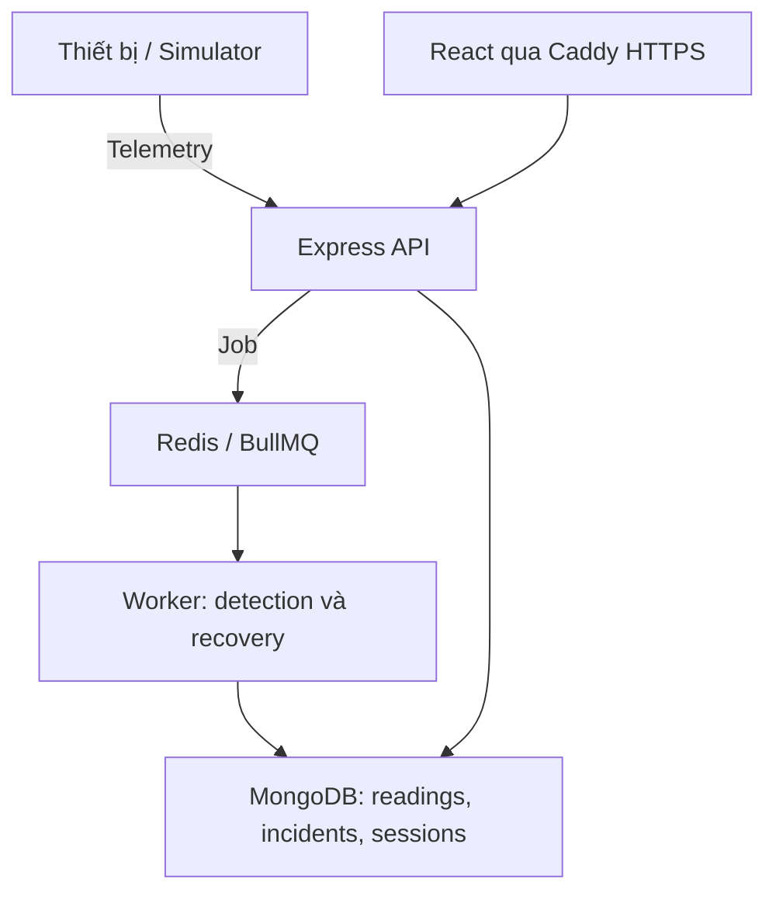

# SensorGuard

SensorGuard thu thập telemetry IoT, xử lý qua hàng đợi và theo dõi sự cố trên dashboard web. Hệ thống hướng tới demo và vận hành nội bộ; triển khai Internet, High Availability và Datadog Cloud cần được kiểm chứng riêng theo môi trường.

## Tính năng

- Nhận telemetry đơn lẻ hoặc theo lô bằng credential dành riêng cho thiết bị.
- Quản lý cảm biến, ngưỡng cảnh báo và lịch sử thay đổi ngưỡng.
- Phát hiện vượt ngưỡng với hysteresis, phát hiện mất kết nối và quản lý vòng đời sự cố.
- Phân tích lịch sử bằng moving average, EWMA và Z-score. Các dấu bất thường thống kê phục vụ biểu đồ, không tự tạo incident.
- RCA theo quy tắc: cung cấp bằng chứng và giả thuyết, không khẳng định nguyên nhân vật lý.
- Recovery có phê duyệt và kiểm chứng bằng telemetry mới; hiện mô phỏng phục hồi, không điều khiển thiết bị thật.
- Demo Center với ba kịch bản: Server Overheating, Pump Vibration và Connection Loss.
- Đăng nhập bằng session và phân quyền ADMIN, OPERATOR, VIEWER.

## Công nghệ

| Thành phần | Công nghệ |
|---|---|
| API và worker | Node.js, Express, BullMQ |
| Giao diện | React, TypeScript, Vite, Recharts |
| Dữ liệu | MongoDB 7 Time Series, Redis 7 |
| Triển khai | Docker Compose, Caddy HTTPS |
| Quan sát | dd-trace, JSON logs, DogStatsD custom metrics |
| Kiểm thử | Node Test Runner, Vitest, GitHub Actions |

Docker và CI dùng Node.js 22; môi trường local có thể dùng Node.js 24.

## Kiến trúc



Worker lưu readings, đánh giá ngưỡng và cập nhật sự cố. Dashboard polling để hiển thị trạng thái. MongoDB và Redis của cấu hình staging hiện tại là standalone; cấu hình này chưa cung cấp HA.

## Bắt đầu nhanh

Yêu cầu Node.js 22/24, npm, MongoDB 7 và Redis 7. Từ thư mục gốc:

```sh
npm ci
npm --prefix frontend ci
```

Sao chép `.env.example` thành `.env`, đặt credential riêng và cấu hình MongoDB/Redis. Với database mới, chạy:

```sh
npm run db:setup
```

Tạo tài khoản quản trị bằng `scripts/create-admin.js <username>`, truyền mật khẩu qua stdin từ nguồn nhập an toàn. Mật khẩu cần ít nhất 16 ký tự, tối đa 256 byte. Không đặt mật khẩu trong command line hoặc Git.

Mở ba terminal và chạy lần lượt:

```sh
npm start
npm run worker
npm run frontend:dev
```

Truy cập `http://localhost:5173`. Frontend dùng session cookie; device key chỉ dành cho simulator hoặc thiết bị.

## Cấu hình môi trường

| Biến | Ý nghĩa |
|---|---|
| `MONGODB_URI`, `MONGODB_DB_NAME` | Kết nối và database ứng dụng |
| `REDIS_HOST`, `REDIS_PORT`, `REDIS_USERNAME`, `REDIS_PASSWORD` | Kết nối Redis |
| `DEVICE_API_KEY` | Credential riêng cho telemetry, ít nhất 32 ký tự |
| `AUTH_ORIGINS` | Danh sách origin chính xác; production yêu cầu HTTPS |
| `LEGACY_API_KEY_ENABLED` | Tắt bằng `false` khi dùng session và device key |
| `WORKER_CONCURRENCY`, `TELEMETRY_ATTEMPTS`, `TELEMETRY_BACKOFF_MS` | Concurrency và retry của worker |

Xem các biến bổ sung và mặc định trong [.env.example](.env.example) và [env.js](src/config/env.js). Không tái sử dụng credentials staging cho QA.

## Triển khai Docker local

Chỉ với **cài đặt mới**, tạo cấu hình riêng rồi khởi động:

```sh
node scripts/prepare-staging.js
docker compose --env-file .env.staging.local -f deploy/compose.yml up -d --build
docker compose --env-file .env.staging.local -f deploy/compose.yml ps
```

Truy cập `https://localhost:8443` sau khi thiết lập tin cậy CA local của Caddy. Tạo admin trong container API bằng script ở trên và stdin an toàn.

**Staging hiện hữu:** giữ nguyên env file, Compose project, volumes và các overlays đang sử dụng. Làm theo [hướng dẫn Docker](docs/docker-operations.md) để bảo toàn database, CA và khả năng rollback.

Dừng bằng `docker compose ... stop` với đúng các tham số của deployment. Không thêm `-v` vào thao tác dừng/xóa container có dữ liệu cần giữ.

## Kiểm thử

```sh
npm test
npm run frontend:test
npm run frontend:typecheck
npm run frontend:build
node scripts/check-observability.js
node scripts/secret-check.js
npm audit
npm --prefix frontend audit
```

Các bài MongoDB integration yêu cầu fixture cô lập tại `mongodb://127.0.0.1:27029`, dbpath `/scratch/phase9-mongo-<số>`, và biến `PHASE9_TEST_MONGO_URI`. Thiếu fixture, chúng được báo skipped. Không trỏ fixture vào staging.

[Workflow Verify](https://github.com/Edward2106/SensorGuard/actions/workflows/verify.yml) chạy MongoDB integration và E2E API/queue/worker. Xem [reliability testing](docs/reliability-testing.md) và [phương pháp benchmark](docs/benchmark-methodology.md) cho kiểm thử chuyên sâu. Kết quả phụ thuộc commit và môi trường, không có số PASS cố định trong README.

## Datadog Observability

Chạy `npm run start:observed` và `npm run worker:observed` để preload tracer trước Node.js ESM. Chỉ bật gửi dữ liệu trong môi trường đã được phép:

| Biến | Cấu hình QA |
|---|---|
| `DD_SITE` | `us5.datadoghq.com` |
| `DD_ENV` | `qa` |
| `DD_TRACE_ENABLED` | `true` |
| `DD_AGENT_HOST` | Hostname Agent trên mạng QA private |
| `DD_DOGSTATSD_PORT` | `8125` mặc định |
| `SENSORGUARD_METRICS_ENABLED` | Bật metric cơ bản bằng `true` |
| `SENSORGUARD_RECOVERY_METRICS_ENABLED` | Opt-in riêng cho metric recovery |
| `SENSORGUARD_WORKFLOW_METRICS_ENABLED` | Opt-in riêng cho demo và heartbeat |
| `SENSORGUARD_GAUGES_ENABLED` | Chỉ bật trên một worker phụ trách global gauges |

Launcher đặt service thành `sensorguard-api` hoặc `sensorguard-worker`; profiling, AppSec, runtime metrics, data streams và remote configuration được tắt. API key của Datadog chỉ được inject cho Agent, không lưu trong Git hoặc frontend.

JSON logs có rotation theo dung lượng và trace/span correlation khi có active span. Mẫu [dashboard](monitoring/dashboard.json), [monitors](monitoring/monitors.json) và [Windows log collection](monitoring/windows/sensorguard.d/conf.yaml) cần cấu hình theo môi trường thực tế.

Offline lint hoặc UDP receiver chỉ xác nhận cấu hình/transport cục bộ. Agent ingestion, Cloud APM, Logs, Metrics, dashboard, monitors và trace xuyên queue phải được xác minh riêng. Kiểm tra organization, quota và chi phí trước khi gửi Cloud. Xem [trạng thái audit](docs/release-audit-2026-11-06.md).

## Bảo mật

Session lưu trong MongoDB; mật khẩu băm scrypt; cookie HttpOnly và SameSite Strict, Secure trong production. API kiểm tra Origin, CSRF headers, RBAC và giới hạn request. Giữ MongoDB/Redis trên mạng private, giới hạn cổng host ở loopback và dùng HTTPS cho production.

Không đưa secrets vào `VITE_*`, browser storage, log hoặc commit. Secret scan theo mẫu không chứng minh toàn bộ lịch sử Git không có secret. Xem [vận hành và backup](docs/docker-operations.md) trước khi thay đổi deployment.

## Cấu trúc dự án

| Thư mục | Nội dung |
|---|---|
| `src/` | API, auth, queues, xử lý telemetry và observability |
| `frontend/` | Dashboard React và kiểm thử giao diện |
| `simulator/` | Thiết bị mô phỏng |
| `deploy/` | Docker, HTTPS và cấu hình triển khai |
| `monitoring/` | Dashboard, monitors và cấu hình thu log |
| `scripts/`, `tests/` | Công cụ vận hành và kiểm thử |
| `docs/` | Hướng dẫn vận hành, giới hạn và phương pháp đánh giá |

## Giấy phép

`package.json` khai báo ISC. Repository hiện chưa có file `LICENSE` riêng.
