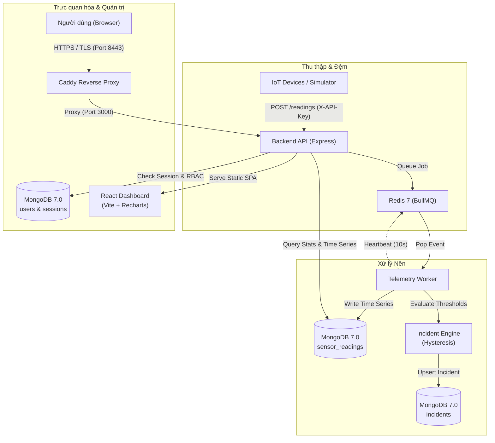

# SensorGuard — Hệ thống giám sát IoT & phát hiện bất thường thời gian thực

SensorGuard là nền tảng thu thập dữ liệu vi mô từ cảm biến IoT, xử lý luồng sự kiện qua hàng đợi bất đồng bộ và lưu trữ tối ưu trên MongoDB Time Series. Hệ thống tự động nhận diện chỉ số vượt ngưỡng bằng cơ chế chống rung (hysteresis), phát hiện bất thường thống kê nâng cao (Moving Average, EWMA, Z-Score) và trực quan hóa toàn diện trên giao diện web đa nền tảng.

---

## Mục lục
- [1. Tổng quan](#1-tổng-quan)
- [2. Tính năng nổi bật](#2-tính-năng-nổi-bật)
- [3. Công nghệ sử dụng](#3-công-nghệ-sử-dụng)
- [4. Kiến trúc hệ thống](#4-kiến-trúc-hệ-thống)
- [5. Cài đặt và chạy Demo](#5-cài-đặt-và-chạy-demo)
- [6. Kiểm thử và chất lượng mã nguồn](#6-kiểm-thử-và-chất-lượng-mã-nguồn)
- [7. Giới hạn hiện tại](#7-giới-hạn-hiện-tại)
- [8. Thông tin dự án](#8-thông-tin-dự-án)
- [9. Incident Intelligence & Verified Demo](#9-incident-intelligence--verified-demo--local-preview)

---

## 1. Tổng quan

* **Bài toán giải quyết**: Giám sát phân tán nhiều thiết bị phần cứng (nhiệt độ, độ ẩm, độ rung) theo thời gian thực; tránh nghẽn cổ chai khi lưu lượng tăng đột biến; giảm thiểu báo động giả do nhiễu đo lường; cung cấp công cụ phân tích xu hướng lịch sử có giới hạn tải nghiêm ngặt.
* **Mục tiêu**: Đảm bảo luồng dữ liệu viễn trắc (telemetry) được hấp thụ an toàn qua bộ đệm hàng đợi, dữ liệu chuỗi thời gian nén gọn, truy vấn thống kê nhanh và kiểm soát truy cập được kiểm thử theo vai trò.
* **Đối tượng sử dụng**: Kỹ sư vận hành hệ thống (Operator), Chuyên viên phân tích (Viewer/Analyst) và Quản trị viên (Admin) phụ trách thiết bị IoT công nghiệp.

---

## 2. Tính năng nổi bật

### IoT Monitoring & Ingestion
* **Thu thập linh hoạt**: Hấp thụ telemetry đơn lẻ hoặc theo lô (batch) qua REST API với API Key chuyên dụng cho thiết bị (`DEVICE`).
* **Đệm hàng đợi bất đồng bộ**: Sử dụng BullMQ trên nền Redis để san phẳng lưu lượng ghi, tách biệt hoàn toàn tiến trình API và tiến trình xử lý nền (Worker).
* **Quản lý cảm biến**: Đăng ký, cập nhật cấu hình ngưỡng, phân loại theo khu vực (zone) và cơ sở (facility), lọc và tìm kiếm nhanh.

### Advanced Analytics (Trọng tâm Phase 9)
* **MongoDB Time Series Aggregation**: Khai thác pipeline `$dateTrunc` UTC, `$setWindowFields` và `$shift` giới hạn tối đa 100.000 bản ghi, chống tràn bộ nhớ và chống rò rỉ dữ liệu tương lai.
* **Moving Average & EWMA nhân quả**: Baseline trượt và EWMA chỉ sử dụng các bucket quan sát trong quá khứ, không lấy dữ liệu hiện tại làm baseline của chính nó.
* **Z-score Anomaly Detection**: Đánh dấu trực quan các điểm dị biệt vượt ngưỡng thống kê (|Z| ≥ 3 hoặc độ lệch EWMA theo ngưỡng cấu hình).
* *Lưu ý*: Các điểm dị biệt thống kê (Statistical Anomaly Markers) hiện phục vụ trực quan hóa phân tích xu hướng, không tự động kích hoạt tạo sự cố.

### Incident Management & Hysteresis
* **Chống rung (Hysteresis)**: Ngăn chặn cảnh báo chập chờn khi chỉ số dao động quanh ngưỡng kích hoạt.
* **Tự động phục hồi**: Yêu cầu liên tiếp nhiều bản ghi đạt ngưỡng an toàn trước khi tự động đóng sự cố.
* **Vòng đời sự cố**: Quản lý trạng thái minh bạch: `open` → `acknowledged` → `resolved`.

### Authentication & RBAC
* **Phiên làm việc bảo mật**: Lưu phiên trong MongoDB, mật khẩu băm thuật toán `scrypt` kèm salt ngẫu nhiên, cookie `HttpOnly`, `SameSite=Strict`.
* **Phân quyền 3 vai trò**:
  * `ADMIN`: Toàn quyền quản trị người dùng, cấu hình và giám sát.
  * `OPERATOR`: Quản lý cảm biến và xử lý sự cố.
  * `VIEWER`: Chỉ xem bảng điều khiển và đồ thị phân tích, không có quyền chỉnh sửa.
* **Chống CSRF & Rebinding**: Kiểm tra nghiêm ngặt custom headers và nguồn gốc Origin.

### System Health & Observability
* **Probes**: `/health` (kiểm tra tiến trình), `/ready` (kiểm tra kết nối MongoDB/Redis), `/api/v1/workers` (giám sát nhịp tim Worker).
* **Worker Heartbeat Registry**: Nhịp tim worker ghi nhận định kỳ vào Redis, tự phát hiện trạng thái trễ (stale sau 30 giây).

---

## 3. Công nghệ sử dụng

| Tầng hệ thống | Công nghệ | Mục đích |
| :--- | :--- | :--- |
| **Backend** | Node.js (Docker 22; local đã kiểm tra 24), Express 4 | REST API, Business Logic, Security Boundary |
| **Frontend** | React 19, TypeScript, Vite, Recharts | Giao diện điều khiển SPA, vẽ biểu đồ phân tích thời gian thực |
| **Database** | MongoDB 7.0 (Time Series Collections) | Lưu trữ chuỗi thời gian nén và tổng hợp thống kê |
| **Message Queue** | Redis 7, BullMQ, ioredis | Đệm sự kiện viễn trắc, đồng bộ heartbeat worker |
| **Infrastructure** | Docker, Docker Compose, Caddy 2 | Container hóa, reverse proxy TLS nội bộ, cô lập mạng |
| **Observability** | Datadog tracer (`dd-trace`), logger JSON nội bộ | Tích hợp APM, structured logging định dạng JSON |
| **CI / Testing** | GitHub Actions, Node Test Runner, Vitest | Tự động hóa kiểm thử, typecheck, build và quét an ninh |

*Ghi chú*: Mã nguồn đã tích hợp sẵn thư viện `dd-trace` và log JSON tương thích Datadog; việc đẩy số liệu lên Datadog Cloud tùy thuộc vào khóa API và agent cấu hình tại môi trường chạy.

---

## 4. Kiến trúc hệ thống



---

## 5. Cài đặt và chạy Demo

### Yêu cầu tiên quyết
* **Hệ điều hành**: Windows 10/11, macOS, Linux.
* **Công cụ**: Docker Desktop (hỗ trợ Compose v2), Node.js 22 hoặc 24 cho môi trường đã kiểm thử.

### Khởi chạy môi trường Staging (HTTPS nội bộ)
Hệ thống Staging mẫu được cấu hình đầy đủ mạng cô lập, xác thực bảo mật và Caddy TLS tự cấp chứng chỉ tại cổng `8443`.

1. **Chuẩn bị cấu hình môi trường**:
   Với cài đặt mới, tạo credentials staging độc lập (script từ chối ghi đè file đã có):
   ```powershell
   node scripts/prepare-staging.js
   ```
   Nếu staging đã có dữ liệu, giữ nguyên file env và project Compose đang sử dụng; không tạo credentials mới cho volume cũ.

   *(Tệp `.env.staging.local` chứa các biến: `MONGO_ROOT_PASSWORD`, `MONGO_APP_PASSWORD`, `REDIS_PASSWORD`, `DEVICE_API_KEY`. Không dùng mật khẩu mặc định trên production).*

2. **Khởi động các dịch vụ**:
   ```powershell
   docker compose --env-file .env.staging.local -f deploy/compose.yml up -d --build
   ```

3. **Kiểm tra trạng thái container**:
   ```powershell
   docker compose --env-file .env.staging.local -f deploy/compose.yml ps
   ```
   *Đảm bảo các container `api`, `worker`, `mongo`, `redis`, `proxy` đều ở trạng thái `healthy` hoặc `running`.*

4. **Truy cập ứng dụng**:
   Mở trình duyệt tại: **`https://localhost:8443`**
   *(Do sử dụng chứng chỉ TLS nội bộ tự ký bởi Caddy trong môi trường local, thiết lập tin cậy chứng chỉ gốc của Caddy trước khi đăng nhập; không tắt kiểm tra TLS).*

5. **Dừng hệ thống an toàn (Bảo toàn dữ liệu)**:
   ```powershell
   # Dừng container mà KHÔNG xóa volumes dữ liệu
   docker compose --env-file .env.staging.local -f deploy/compose.yml stop
   ```

---

## 6. Kiểm thử và chất lượng mã nguồn

Kết quả chạy local ngày 27/10/2026 cho working tree preview (không thay thế xác nhận GitHub CI):

* **Backend Test Suite**: **65/65 PASS**, không skip, bao gồm kiểm thử Time Series trên MongoDB thật, Z-score, EWMA, kiểm thử tràn bộ nhớ, RBAC 3 vai trò và chu kỳ sự cố Phase 8 regression.
* **Frontend Test Suite**: **28/28 PASS** (5 gateway boundary tests + 23 React component tests).
* **TypeScript & Build**: Typecheck `tsc --noEmit` đạt 0 lỗi; Vite production build thành công.
* **Kiểm tra an ninh**: `npm audit` đạt **0 vulnerabilities** ở cả backend và frontend; quét mẫu secrets đạt; đây không phải chứng nhận an toàn tuyệt đối.
* **GitHub Actions CI**: Workflow `Verify` có MongoDB 7 integration và E2E API/queue/worker thật. Đối chiếu trạng thái theo đúng commit tại [GitHub Actions](https://github.com/Edward2106/SensorGuard/actions/workflows/verify.yml); kết quả local không thay thế bằng chứng CI.

---

## 7. Giới hạn hiện tại

1. **Event-time Reconstruction**: Thống kê lịch sử được tái dựng theo nhãn thời gian của bản ghi (event time). Các bản ghi gửi đến trễ có thể cập nhật lại số liệu các bucket trong quá khứ.
2. **Current Thresholds**: Biểu đồ phân tích áp dụng ngưỡng cấu hình hiện tại của cảm biến, chưa lưu vết lịch sử thay đổi ngưỡng theo từng mốc thời gian.
3. **Statistical Anomaly Isolation**: Điểm dị biệt thống kê (Z-score/EWMA) hiện chỉ đóng vai trò phân tích trực quan trên dashboard, không tự kích hoạt tạo sự cố (Incident) để bảo đảm ổn định hệ thống.
4. **Kênh thông báo ngoại vi**: Chưa kích hoạt thông báo sự cố đẩy ra bên ngoài qua Email, SMS hay Webhook.
5. **Môi trường Internet**: Chưa thiết lập triển khai công khai ngoài Internet; hiện sẵn sàng cho môi trường nội bộ/Staging.

---

## 8. Thông tin dự án

* **Mã nguồn**: [GitHub — Edward2106/SensorGuard](https://github.com/Edward2106/SensorGuard)
* **Giấy phép (License)**: ISC License

## 9. Incident Intelligence & Verified Demo — local preview

### Chức năng hiện có

- **RCA xác định bằng quy tắc**: `Incident intelligence` phân tích một giờ trước thời điểm trigger gốc, dùng thống kê Phase 9 và mở đầu history của incident. Có spike, suy giảm dần, quá nhiệt kéo dài, rung bất thường, mất kết nối, thiếu telemetry, dao động và độ phân tán lớn. Đây là các chỉ báo theo quy tắc, không phải kết luận nguyên nhân vật lý hay mô hình ML đã huấn luyện. `Evidence Strength` không phải xác suất được hiệu chuẩn.
- **Chống suy diễn sai lịch sử**: không dùng severity/observedAt mới nhất để thay thời điểm trigger gốc. Incident mới lưu value/threshold trong opening history. Đây là ngưỡng detector dùng lúc xử lý, chưa chứng minh ngưỡng có hiệu lực tại event time nếu reading đến trễ. Incident cũ thiếu snapshot được báo unavailable; chưa có threshold versioning đầy đủ. Dữ liệu đến trễ vẫn có thể thay đổi tái dựng theo event time.
- **Recovery riêng biệt**: `DETECTED → ANALYZED → ACTION_PROPOSED → USER_APPROVED → SIMULATED_REMEDIATION → VERIFYING_RECOVERY → VERIFIED / FAILED / TIMED_OUT`. Chỉ ghi nhận hành động mô phỏng, không điều khiển thiết bị thật và không trực tiếp resolve incident.
- **Bằng chứng recovery**: ba event khác nhau, timestamp tăng, thời điểm API enqueue (`receivedAt`) và event time đều sau phê duyệt, đã durable/detection hoàn tất; readings qua hysteresis và incident do detector tự resolve với recoveryEventId thuộc chuỗi mới. Replay, receipt cũ/thiếu, manual resolve và timer không tạo thành công. Ba readings không an toàn liên tiếp là FAILED; hết 120 giây thiếu bằng chứng là TIMED_OUT. Worker kiểm tra tối đa 20 workflow mỗi 5 giây; API có thể yêu cầu kiểm tra thêm. CAS/version chống phê duyệt hoặc kết thúc trùng.
- **Demo Center**: ba kịch bản Server Overheating, Pump Vibration, Connection Loss. ADMIN khởi chạy; ADMIN/OPERATOR phê duyệt; VIEWER chỉ xem. Một lease toàn cục, worker concurrency 1, mỗi lượt tối đa 5 phút, sensor `DEMO-*` riêng và metadata simulated. Temperature/vibration gửi 5 readings baseline có timestamp quá khứ được ghi rõ là tổng hợp, rồi anomaly hiện tại và 3 recovery readings mới; connection loss đợi health worker thật. Telemetry luôn đi qua REST API → BullMQ → worker → Time Series. Kết thúc chuyển sensor demo sang maintenance, không xóa dữ liệu.

Các collections mới: `recovery_workflows`, `demo_runs`, `demo_control`; mặc định chỉ dùng index `_id`. Không có migration phá vỡ tương thích hoặc compound index mới trên staging. Nhiều worker/process có thể cùng kiểm tra workflow; trạng thái cuối được bảo vệ bằng CAS. Demo bị dừng cùng worker được báo FAILED an toàn, không giả vờ hoàn thành; không có cam kết tự tiếp tục mọi kịch bản sau crash.

### API mới

| Endpoint | Quyền / hành vi |
|---|---|
| `GET /api/v1/incidents/:alertId/analysis` (alias alerts cũng có) | Đọc có Auth, cửa sổ cố định 1 giờ, tối đa 2 RCA đồng thời mỗi process; giới hạn aggregation Phase 9 vẫn áp dụng |
| `POST /api/v1/recovery/propose` với `{incidentId}` | Human ADMIN/OPERATOR, một workflow idempotent mỗi incident |
| `GET /api/v1/recovery/:id` | Vai trò đọc hiện có; DEVICE bị chặn |
| `PATCH /api/v1/recovery/:id/approve` với `{confirmSimulation:true}` | ADMIN/OPERATOR, yêu cầu CSRF/session; từ chối nếu cấu hình sensor thay đổi hoặc monitoring bị tắt |
| `POST /api/v1/recovery/:id/verify` | ADMIN/OPERATOR, đối chiếu telemetry mới và detector recovery |
| `POST /api/v1/demos` với `{scenario:"SERVER_OVERHEATING"}` | Human ADMIN; scenario khác: `PUMP_VIBRATION`, `CONNECTION_LOSS` |
| `GET /api/v1/demos` | Đọc 20 lượt gần nhất, không nhận tham số tăng giới hạn; giúp tìm lại lượt sau request timeout |
| `GET /api/v1/demos/:id` | Đọc timeline/status/evidence; không trả credentials |

UI dùng cookie HttpOnly/CSRF và gateway allowlist hiện có; không có key VITE_* hay secret trong storage. Run Demo và Approve đều có xác nhận. Analytics là snapshot theo Apply; Demo polling 2 giây khi active, không phải WebSocket.

### Chạy preview và rollback

Staging hiện hữu đã dùng `.env.staging`; giữ đúng file credentials của volume đang có. Với môi trường đó:

```powershell
docker compose --env-file .env.staging -f deploy/compose.yml -f deploy/compose.preview.yml config --quiet
docker compose --env-file .env.staging -f deploy/compose.yml -f deploy/compose.preview.yml up -d --build
```

Mở `https://localhost:8443`, đăng nhập tài khoản được cấp, vào Demo Center. Phê duyệt simulation khi timeline tới AWAITING_APPROVAL; xem kết quả/evidence từ backend. Không có mật khẩu mặc định hoặc đăng ký công khai. Nút Load recent demo runs đọc lịch sử giới hạn; Incident Center và Demo Center có liên kết mở RCA trực tiếp. Không chọn Run Demo trên database chứa dữ liệu thật nếu chưa được chủ môi trường cho phép; ưu tiên QA riêng.

Image Phase 9 `sensorguard-phase9:verified-local` được giữ để rollback API/worker bằng overlay chỉ đổi image sau khi drain queues; không rollback/xóa dữ liệu. Backup ứng dụng trước preview ở `backups/staging-pre-intelligence-1793106721080.archive.gz`, SHA256 và kết quả restore ở `scratch/intelligence-backup.json`. Backup này cố ý không chứa auth users/sessions/limits; restore QA có 10 sensors, 50 readings, 15 incidents, 50 telemetry events và Time Series đúng cấu trúc. Không restore đè staging.

### Kiểm thử và giới hạn phát hành

- Unit + MongoDB 7.0.45 integration: 65/65; frontend 28/28; typecheck và production build đạt. Có regression original-trigger/no-future-leakage, legacy threshold, spike/gradual, concurrent approval, replay/stale/duplicate timestamp, detector recovery, persisted timeout, failed recovery và UDP metrics nhận tại loopback.
- E2E thật trên API + Redis/BullMQ + worker + MongoDB QA: cả ba kịch bản và một lượt quá nhiệt lặp lại VERIFIED, 31 readings durable tổng cộng trong một bộ 4 lượt. Đây là kiểm thử chức năng có giới hạn, không phải benchmark throughput hoặc accuracy có nhãn.
- `npm.cmd run verify:intelligence` yêu cầu hạ tầng QA chuyên biệt, DB prefix `sg_intelligence_qa_`, host Mongo `sensorguard-phase9-mongo7-qa` hoặc `phase9-ci-mongo` cổng 27029 và Redis QA cho phép. Script từ chối development/staging, tạo accounts QA ngẫu nhiên rồi disable khi kết thúc. Bằng chứng local ở `scratch/`, không commit credentials/logs/dumps.
- Datadog: code recovery counters và dashboard template đã thêm; UDP local đã kiểm tra. Cloud ingestion/dashboards/monitors **UNVERIFIED**, không bật thêm dịch vụ tính phí. Recovery counters cần thêm opt-in riêng `SENSORGUARD_RECOVERY_METRICS_ENABLED=true` bên cạnh cờ metrics chung; mặc định không phát các series mới. Counters best-effort chỉ emit sau thay đổi CAS thành công; audit MongoDB mới là nguồn xác thực trạng thái, không dùng counters làm sổ cái.
- Đã kiểm tra Redis/MongoDB QA ngắt-khôi phục (503/fail-closed, không mất readings) và SIGKILL/restart worker QA: job replay vẫn có 9 readings, recovery VERIFIED sau phê duyệt. Chưa có kiểm định độc lập security, full chaos matrix/multi-replica zombie-worker tests, threshold versioning toàn bộ hoặc durability SLA khi mất toàn bộ hạ tầng. Caddy hiện lưu CA dưới filesystem container thay vì volume `/data`; cần kế hoạch di chuyển CA có backup trước khi recreate proxy. Preview không recreate proxy và không bỏ TLS validation.
- Phạm vi phát hành là local/staging preview. Trạng thái GitHub CI phải đối chiếu đúng commit được push, không suy từ kết quả local. Cloud, benchmark đối chứng và production SLA chưa được kiểm chứng.

### So sánh có giới hạn

Đã đọc public commit `77c6328db3e1e4b5987fd9e0355620b24324d40b` của [ddloi/sensorguard-iot](https://github.com/ddloi/sensorguard-iot/commit/77c6328db3e1e4b5987fd9e0355620b24324d40b), không sửa/chạy bằng credentials của repo đó và không sao chép mã.

| Metric | Edward result | Loi result | Điều kiện / bằng chứng | Kết luận / giới hạn |
|---|---|---|---|---|
| Analytics latency | Phase 9 lịch sử: median 99,46→105,63 ms, p95 132,64→147,87 ms sau index | Chưa đo | 240.000 readings, Mongo 8.3.2 local; raw explain trong scratch | NOT COMPARABLE; scan giảm không đồng nghĩa nhanh hơn |
| Ingestion throughput / p99 | Chưa đo lại trên preview | Chưa đo | E2E nhỏ không phải load benchmark | NOT COMPARABLE |
| Recovery correctness | 4/4 E2E QA có 3 event mới + detector resolve | Static source review: remediation worker mô phỏng bằng timer rồi resolve | [Source đối chứng, commit cố định](https://github.com/ddloi/sensorguard-iot/blob/77c6328db3e1e4b5987fd9e0355620b24324d40b/packages/api/src/workers/remediation.worker.ts); không chạy comparator | Cơ chế verification khác nhau; chưa có so sánh runtime ngang điều kiện |
| Analytics baseline | Test xác nhận prior-only, zero variance/warm-up explicit | Source analytics window gồm current observation | [Source đối chứng](https://github.com/ddloi/sensorguard-iot/blob/77c6328db3e1e4b5987fd9e0355620b24324d40b/packages/api/src/routes/analytics.ts) | Khác định nghĩa baseline; không thể so accuracy trực tiếp |
| Precision/Recall/F1 | Chưa có dataset nhãn độc lập | Chưa đo | Không gán nhãn sau khi xem kết quả | NOT COMPARABLE |
| Security / DX / memory | Có tests và build local được báo cụ thể | Chưa chạy suite / đo tài nguyên | Review vài file không phải audit đầy đủ comparator | Không chấm điểm hoặc tuyên bố vượt trội toàn diện |

### Lệnh kiểm thử Windows và bootstrap ban đầu

Full backend cần MongoDB QA riêng cổng 27029 với dbPath dạng `/scratch/phase9-mongo-<digits>`; nếu thiếu biến URI, các integration tests sẽ skip. Không trỏ vào development hoặc staging. Container QA đã tạo trong lần kiểm chứng có thể khởi động lại mà không xóa dữ liệu:

```powershell
docker start sensorguard-phase9-mongo7-qa
$env:PHASE9_TEST_MONGO_URI='mongodb://127.0.0.1:27029'
$env:SENSORGUARD_METRICS_ENABLED='false'
$env:DD_TRACE_ENABLED='false'
npm.cmd test
npm.cmd run frontend:test
npm.cmd run frontend:typecheck
npm.cmd run frontend:build
# Khi đã có stack QA riêng như bước E2E trong .github/workflows/verify.yml:
docker exec sensorguard-intelligence-api-qa node scripts/verify-intelligence.js
```

Với cài đặt mới chưa có administrator, script bootstrap đọc password từ stdin và từ chối ghi đè account. Dùng đúng env file của môi trường; không áp dụng để thay credentials đang có:

```powershell
$adminSecret = Read-Host 'Password administrator (ít nhất 16 ký tự)' -AsSecureString
$adminPlain = [System.Net.NetworkCredential]::new('', $adminSecret).Password
$adminPlain | docker compose --env-file .env.staging.local -f deploy/compose.yml exec -T api node scripts/create-admin.js admin
Remove-Variable adminPlain, adminSecret
```

### Benchmark MongoDB 7.0.45 đo lại ngày 27/10/2026

Đã dừng API/worker QA khi đo; staging không chịu benchmark. Cùng script/dataset 240.000 readings trên 4 sensors, 5 warm-up +50 samples cho mỗi phía, không hint; query một sensor/60.000 readings →1.000 bucket.

| Metric | Trước compound index | Sau compound index (chỉ fixture) |
|---|---:|---:|
| Median client latency |103,93 ms|89,21 ms|
| p95 |149,77 ms|116,31 ms|
| p99 |173,85 ms|125,63 ms|
| cursor docsExamined (storage buckets) |240|60|
| cursor keysExamined |0|61|
| explain executionTimeMillis, một phép đo riêng |82 ms|105 ms|
| Median insert batch 1.000 readings |10,46 ms|10,93 ms|

Median query giảm trong lượt MongoDB 7 này, nhưng write cost tăng và một explain sample lại chậm hơn. Lượt MongoDB 8.3.2 trước từng cho median tăng 99,46→105,63 ms; giữ nguyên cả kết quả bất lợi đó. Không suy diễn lợi ích chung hoặc SLA từ một workload/phase order; p99 là max với n=50, cache/cold state chưa randomized, write concern không mô phỏng cluster durable production. Không tạo index mới trên staging. Raw samples/plans: `scratch/phase9-benchmark-1793111091359.json`. Không có benchmark runtime đối chứng của Lợi nên kết luận cạnh tranh vẫn NOT COMPARABLE.
