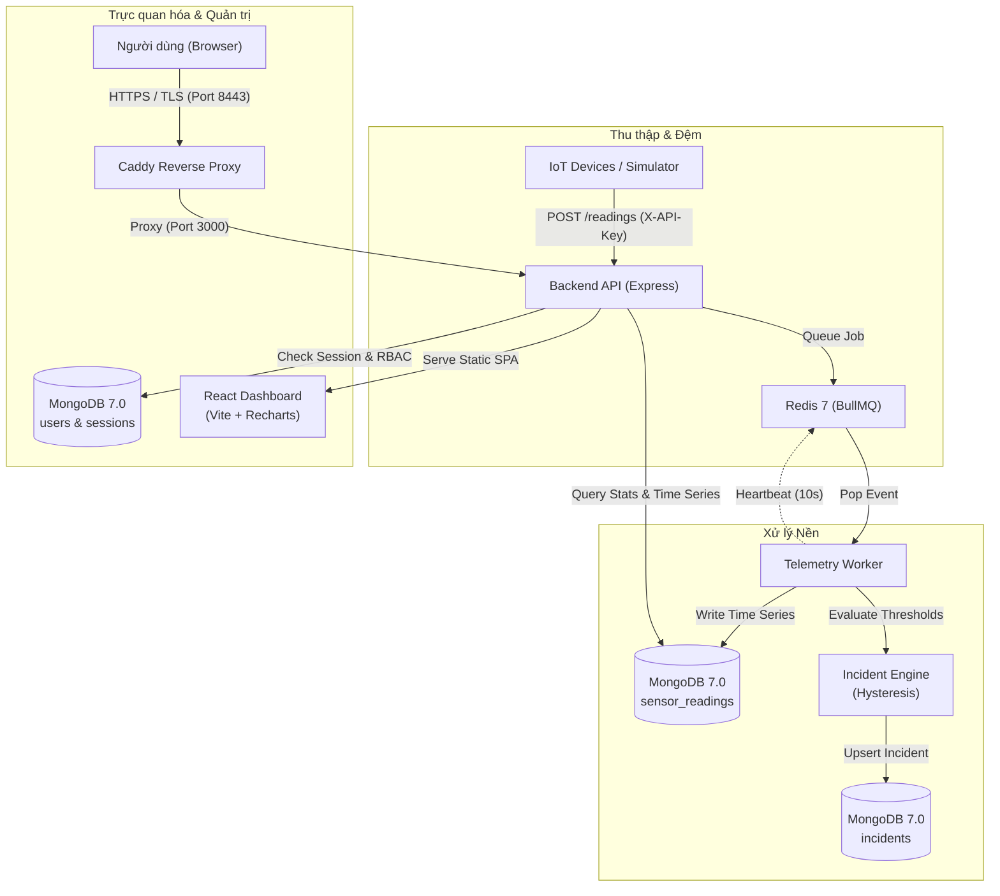

# SensorGuard — Hệ thống giám sát IoT & phát hiện bất thường thời gian thực

SensorGuard là nền tảng thu thập dữ liệu vi mô từ cảm biến IoT, xử lý luồng sự kiện qua hàng đợi bất đồng bộ và lưu trữ tối ưu trên MongoDB Time Series. Hệ thống tự động nhận diện chỉ số vượt ngưỡng bằng cơ chế chống rung (hysteresis), phát hiện bất thường thống kê nâng cao (Moving Average, EWMA, Z-Score) và trực quan hóa toàn diện trên giao diện web đa nền tảng.

---

## Mục lục
- [1. Tổng quan](#1-tổng-quan)
- [2. Tính năng nổi bật](#2-tính-năng-nổi-bật)
- [3. Công nghệ sử dụng](#3-công-nghệ-sử-dụng)
- [4. Kiến trúc hệ thống](#4-kiến-trúc-hệ-thống)
- [5. Cài đặt và chạy Demo](#5-cài-đặt-và-chạy-demo)
- [6. Kiểm thử và chất lượng mã nguồn](#6-kiểm-thử-và-chất-lượng-mã-nguồn)
- [7. Giới hạn hiện tại](#7-giới-hạn-hiện-tại)
- [8. Thông tin dự án](#8-thông-tin-dự-án)
- [9. Incident Intelligence & Verified Demo](#9-incident-intelligence--verified-demo--local-preview)

---

## 1. Tổng quan

* **Bài toán giải quyết**: Giám sát phân tán nhiều thiết bị phần cứng (nhiệt độ, độ ẩm, độ rung) theo thời gian thực; tránh nghẽn cổ chai khi lưu lượng tăng đột biến; giảm thiểu báo động giả do nhiễu đo lường; cung cấp công cụ phân tích xu hướng lịch sử có giới hạn tải nghiêm ngặt.
* **Mục tiêu**: Đảm bảo luồng dữ liệu viễn trắc (telemetry) được hấp thụ an toàn qua bộ đệm hàng đợi, dữ liệu chuỗi thời gian nén gọn, truy vấn thống kê nhanh và kiểm soát truy cập được kiểm thử theo vai trò.
* **Đối tượng sử dụng**: Kỹ sư vận hành hệ thống (Operator), Chuyên viên phân tích (Viewer/Analyst) và Quản trị viên (Admin) phụ trách thiết bị IoT công nghiệp.

---

## 2. Tính năng nổi bật

### IoT Monitoring & Ingestion
* **Thu thập linh hoạt**: Hấp thụ telemetry đơn lẻ hoặc theo lô (batch) qua REST API với API Key chuyên dụng cho thiết bị (`DEVICE`).
* **Đệm hàng đợi bất đồng bộ**: Sử dụng BullMQ trên nền Redis để san phẳng lưu lượng ghi, tách biệt hoàn toàn tiến trình API và tiến trình xử lý nền (Worker).
* **Quản lý cảm biến**: Đăng ký, cập nhật cấu hình ngưỡng, phân loại theo khu vực (zone) và cơ sở (facility), lọc và tìm kiếm nhanh.

### Advanced Analytics (Trọng tâm Phase 9)
* **MongoDB Time Series Aggregation**: Khai thác pipeline `$dateTrunc` UTC, `$setWindowFields` và `$shift` giới hạn tối đa 100.000 bản ghi, chống tràn bộ nhớ và chống rò rỉ dữ liệu tương lai.
* **Moving Average & EWMA nhân quả**: Baseline trượt và EWMA chỉ sử dụng các bucket quan sát trong quá khứ, không lấy dữ liệu hiện tại làm baseline của chính nó.
* **Z-score Anomaly Detection**: Đánh dấu trực quan các điểm dị biệt vượt ngưỡng thống kê (|Z| ≥ 3 hoặc độ lệch EWMA theo ngưỡng cấu hình).
* *Lưu ý*: Các điểm dị biệt thống kê (Statistical Anomaly Markers) hiện phục vụ trực quan hóa phân tích xu hướng, không tự động kích hoạt tạo sự cố.

### Incident Management & Hysteresis
* **Chống rung (Hysteresis)**: Ngăn chặn cảnh báo chập chờn khi chỉ số dao động quanh ngưỡng kích hoạt.
* **Tự động phục hồi**: Yêu cầu liên tiếp nhiều bản ghi đạt ngưỡng an toàn trước khi tự động đóng sự cố.
* **Vòng đời sự cố**: Quản lý trạng thái minh bạch: `open` → `acknowledged` → `resolved`.

### Authentication & RBAC
* **Phiên làm việc bảo mật**: Lưu phiên trong MongoDB, mật khẩu băm thuật toán `scrypt` kèm salt ngẫu nhiên, cookie `HttpOnly`, `SameSite=Strict`.
* **Phân quyền 3 vai trò**:
  * `ADMIN`: Toàn quyền quản trị người dùng, cấu hình và giám sát.
  * `OPERATOR`: Quản lý cảm biến và xử lý sự cố.
  * `VIEWER`: Chỉ xem bảng điều khiển và đồ thị phân tích, không có quyền chỉnh sửa.
* **Chống CSRF & Rebinding**: Kiểm tra nghiêm ngặt custom headers và nguồn gốc Origin.

### System Health & Observability
* **Probes**: `/health` (kiểm tra tiến trình), `/ready` (kiểm tra kết nối MongoDB/Redis), `/api/v1/workers` (giám sát nhịp tim Worker).
* **Worker Heartbeat Registry**: Nhịp tim worker ghi nhận định kỳ vào Redis, tự phát hiện trạng thái trễ (stale sau 30 giây).

---

## 3. Công nghệ sử dụng

| Tầng hệ thống | Công nghệ | Mục đích |
| :--- | :--- | :--- |
| **Backend** | Node.js (Docker 22; local đã kiểm tra 24), Express 4 | REST API, Business Logic, Security Boundary |
| **Frontend** | React 19, TypeScript, Vite, Recharts | Giao diện điều khiển SPA, vẽ biểu đồ phân tích thời gian thực |
| **Database** | MongoDB 7.0 (Time Series Collections) | Lưu trữ chuỗi thời gian nén và tổng hợp thống kê |
| **Message Queue** | Redis 7, BullMQ, ioredis | Đệm sự kiện viễn trắc, đồng bộ heartbeat worker |
| **Infrastructure** | Docker, Docker Compose, Caddy 2 | Container hóa, reverse proxy TLS nội bộ, cô lập mạng |
| **Observability** | Datadog tracer (`dd-trace`), logger JSON nội bộ | Tích hợp APM, structured logging định dạng JSON |
| **CI / Testing** | GitHub Actions, Node Test Runner, Vitest | Tự động hóa kiểm thử, typecheck, build và quét an ninh |

*Ghi chú*: Mã nguồn đã tích hợp sẵn thư viện `dd-trace` và log JSON tương thích Datadog; việc đẩy số liệu lên Datadog Cloud tùy thuộc vào khóa API và agent cấu hình tại môi trường chạy.

---

## 4. Kiến trúc hệ thống



---

## 5. Cài đặt và chạy Demo

### Yêu cầu tiên quyết
* **Hệ điều hành**: Windows 10/11, macOS, Linux.
* **Công cụ**: Docker Desktop (hỗ trợ Compose v2), Node.js 22 hoặc 24 cho môi trường đã kiểm thử.

### Khởi chạy môi trường Staging (HTTPS nội bộ)
Hệ thống Staging mẫu được cấu hình đầy đủ mạng cô lập, xác thực bảo mật và Caddy TLS tự cấp chứng chỉ tại cổng `8443`.

1. **Chuẩn bị cấu hình môi trường**:
   Với cài đặt mới, tạo credentials staging độc lập (script từ chối ghi đè file đã có):
   ```powershell
   node scripts/prepare-staging.js
   ```
   Nếu staging đã có dữ liệu, giữ nguyên file env và project Compose đang sử dụng; không tạo credentials mới cho volume cũ.

   *(Tệp `.env.staging.local` chứa các biến: `MONGO_ROOT_PASSWORD`, `MONGO_APP_PASSWORD`, `REDIS_PASSWORD`, `DEVICE_API_KEY`. Không dùng mật khẩu mặc định trên production).*

2. **Khởi động các dịch vụ cho cài đặt mới** (staging hiện hữu dùng đúng overlays trong tài liệu vận hành, không chạy base-only làm đổi CA storage):
   ```powershell
   docker compose --env-file .env.staging.local -f deploy/compose.yml up -d --build
   ```

3. **Kiểm tra trạng thái container**:
   ```powershell
   docker compose --env-file .env.staging.local -f deploy/compose.yml ps
   ```
   *Đảm bảo các container `api`, `worker`, `mongo`, `redis`, `proxy` đều ở trạng thái `healthy` hoặc `running`.*

4. **Truy cập ứng dụng**:
   Mở trình duyệt tại: **`https://localhost:8443`**
   *(Do sử dụng chứng chỉ TLS nội bộ tự ký bởi Caddy trong môi trường local, thiết lập tin cậy chứng chỉ gốc của Caddy trước khi đăng nhập; không tắt kiểm tra TLS).*

5. **Dừng hệ thống an toàn (Bảo toàn dữ liệu)**:
   ```powershell
   # Dừng container mà KHÔNG xóa volumes dữ liệu
   docker compose --env-file .env.staging.local -f deploy/compose.yml stop
   ```

---

## 6. Kiểm thử và chất lượng mã nguồn

Kết quả regression hardening ngày 29/10/2026 (không thay thế xác nhận GitHub CI):

* **Backend Test Suite**: **72/72 PASS**, không skip, bao gồm kiểm thử Time Series trên MongoDB thật, Z-score, EWMA, kiểm thử tràn bộ nhớ, RBAC 3 vai trò và chu kỳ sự cố Phase 8 regression.
* **Frontend Test Suite**: **30/30 PASS** (5 gateway boundary tests + 25 React component tests).
* **TypeScript & Build**: Typecheck `tsc --noEmit` đạt 0 lỗi; Vite production build thành công.
* **Kiểm tra an ninh**: `npm audit` đạt **0 vulnerabilities** ở cả backend và frontend; quét mẫu secrets đạt; đây không phải chứng nhận an toàn tuyệt đối.
* **GitHub Actions CI**: Workflow `Verify` có MongoDB 7 integration và E2E API/queue/worker thật. Đối chiếu trạng thái theo đúng commit tại [GitHub Actions](https://github.com/Edward2106/SensorGuard/actions/workflows/verify.yml); kết quả local không thay thế bằng chứng CI.

---

## 7. Giới hạn hiện tại

1. **Event-time Reconstruction**: Thống kê lịch sử được tái dựng theo nhãn thời gian của bản ghi (event time). Các bản ghi gửi đến trễ có thể cập nhật lại số liệu các bucket trong quá khứ.
2. **Historical Thresholds**: Có revision atomic và lịch sử ngưỡng kể từ khi tạo/cập nhật qua API mới; dữ liệu cũ không đủ bằng chứng báo `HISTORICAL_THRESHOLD_UNAVAILABLE`. Lịch sử tối đa256 revisions/sensor; chưa có archival hay lịch sử deployment defaults toàn cục.
3. **Statistical Anomaly Isolation**: Điểm dị biệt thống kê (Z-score/EWMA) hiện chỉ đóng vai trò phân tích trực quan trên dashboard, không tự kích hoạt tạo sự cố (Incident) để bảo đảm ổn định hệ thống.
4. **Kênh thông báo ngoại vi**: Chưa kích hoạt thông báo sự cố đẩy ra bên ngoài qua Email, SMS hay Webhook.
5. **Môi trường Internet**: Chưa thiết lập triển khai công khai ngoài Internet; hiện sẵn sàng cho môi trường nội bộ/Staging.

---

## 8. Thông tin dự án

* **Mã nguồn**: [GitHub — Edward2106/SensorGuard](https://github.com/Edward2106/SensorGuard)
* **Giấy phép (License)**: ISC License

## 9. Incident Intelligence, recovery và demo

- **RCA**: tám mẫu theo quy tắc, một giờ trước trigger gốc, prior-only baseline; evidence/hypotheses tách rõ. Đây không phải kết luận nguyên nhân vật lý hay ML được huấn luyện. Giới hạn2 phân tích đồng thời mỗi process.
- **Threshold history**: revision, actor, previous/new, effectiveAt/recordedAt và hash chain được ghi cùng active config bằng CAS. Late readings dùng revision event-time có bằng chứng; legacy giữ live behavior cũ nhưng không khẳng định lịch sử. Biểu đồ bỏ threshold lines cho history thiếu, mixed bucket hoặc khác type/unit.
- **Recovery**: đề xuất → human approval → VERIFYING_RECOVERY → VERIFIED/FAILED/TIMED_OUT. VERIFIED cần3 events an toàn mới sau approval và detector tự resolve incident. Không điều khiển thiết bị thật; timeout/manual resolve không tạo thành công.
- **Demo Center**: ADMIN chạy Server Overheating/Pump Vibration/Connection Loss, ADMIN/OPERATOR phê duyệt, VIEWER đọc. Một lease toàn cục, tối đa5phút; sensor riêng có nhãn simulated. Temperature/vibration có5 baseline timestamps tổng hợp, anomaly hiện tại và3 recovery readings; offline dùng health worker thật. Tất cả telemetry qua REST/BullMQ, không insert incident giả. UI polling2giây khi active, không phải WebSocket.

| API bổ sung (có Auth) | Quyền / giới hạn |
|---|---|
| GET /api/v1/sensors/:sensorId/threshold-history | Đọc tối đa256 revisions; không backfill |
| GET /api/v1/incidents/:alertId/analysis | Đọc; alias alerts; tối đa100.000 readings |
| POST /api/v1/recovery/propose với {incidentId} | Human ADMIN/OPERATOR |
| GET /api/v1/recovery/:id | Đọc; DEVICE bị chặn |
| PATCH /api/v1/recovery/:id/approve với {confirmSimulation:true} | ADMIN/OPERATOR + CSRF; config/revision fence |
| POST /api/v1/recovery/:id/verify | ADMIN/OPERATOR; đối chiếu evidence |
| POST /api/v1/demos với {scenario:"SERVER_OVERHEATING"} | Human ADMIN; hai scenario khác: PUMP_VIBRATION, CONNECTION_LOSS |
| GET /api/v1/demos và GET /api/v1/demos/:id | Lịch sử20 lượt hoặc timeline/evidence của một lượt |

Collections recovery_workflows/demo_runs/demo_control được giữ riêng. Threshold history nằm trong sensor để cập nhật atomic trên MongoDB standalone. Không có migration xóa/backfill hoặc compound index mới trên staging. API giữ cookie HttpOnly, RBAC và CSRF; không có privileged key trong VITE_* hoặc browser storage.

### Vận hành và bằng chứng

- [Docker inventory, QA lifecycle, TLS persistence và rollback](docs/docker-operations.md).
- [Regression, failure tests và threshold history contract](docs/reliability-testing.md).
- [Benchmark methodology, kết quả bất lợi và so sánh có giới hạn](docs/benchmark-methodology.md).
- Datadog: JSON logger/APM integration và custom metrics đã có code; UDP loopback/config lint là LOCAL VERIFIED, Cloud còn UNVERIFIED. Recovery và demo/heartbeat series cần opt-in riêng bên cạnh cờ metrics chung; mặc định không tạo series mới. Không bật paid resources.
- CI dùng action SHAs đã kiểm tra migration guidance, Node24 action runtime, Ubuntu24.04; ứng dụng vẫn Node22. Xem đúng commit tại [Verify](https://github.com/Edward2106/SensorGuard/actions/workflows/verify.yml).
- Staging ngày29/10/2026 đã chuyển CA gốc sang volume persistent sau backup, QA và phê duyệt downtime; HTTPS/ready/heartbeat và3vai trò được kiểm tra. Counts11sensors/59readings/16incidents/59events được bảo toàn; không chạy thêm staging demo. Build image mới không tự deploy staging.
- Giới hạn: full network-partition/multi-replica/failover matrix và production SLA chưa được chứng minh. So sánh runtime với dự án đối chứng vẫn NOT COMPARABLE; không tự chấm điểm hoặc tuyên bố vượt trội toàn diện.
